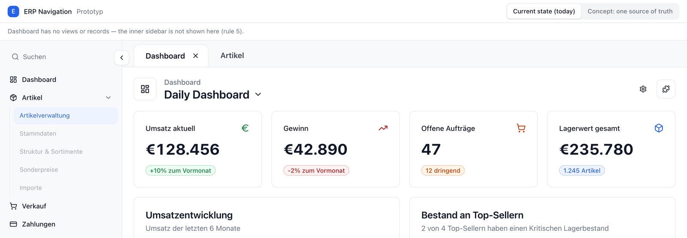
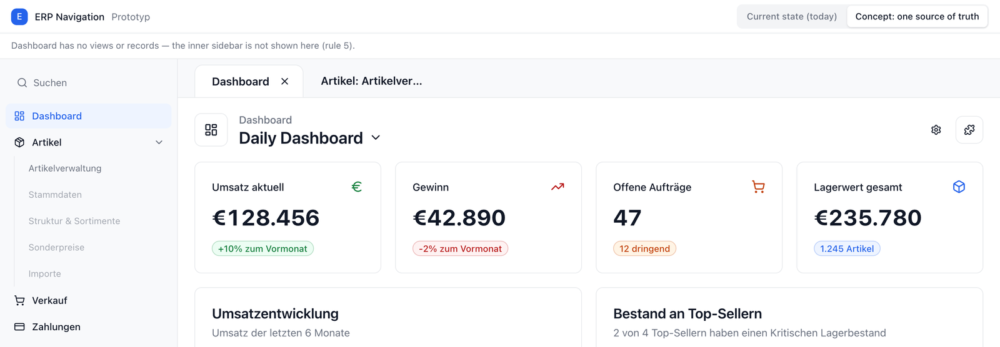

# ERP navigation concept

*A concept for navigation in a cloud ERP.*

**The question:** six navigation layers share one screen of a cloud ERP. Two of them
answer *where am I* on their own, and sometimes they disagree. What is the smallest
change that makes the screen tell one story?

**The answer, in one sentence:** the active tab is the only thing that defines where
the user is; every other layer reflects it.

[Live demo →](https://erp-navigation-concept.vercel.app/)

*Current state — the Dashboard tab is active, the sidebar still says Artikelverwaltung. Two layers, two answers.*

*Concept — the same clicks. The sidebar follows the active tab, and the second tab says what it holds.*

The demo shows the same UI with two behaviour sets. **Current state** reproduces the
findings; **Concept** applies the rule. Every click is narrated with the observation it
reproduces or the rule it obeys. The UI is in German, as in the product.

## Contents

- [The task](#the-task)
- [How I approached it](#how-i-approached-it)
- [Part 1 · Navigation](#part-1--navigation): 12 observations, choosing the problem, one source of truth, two models
- [Part 2 · Testing an AI assistant in the work screen](#part-2--testing-an-ai-assistant-in-the-work-screen)
- [Part 3 · Documenting an AI agent so other teams can reuse it](#part-3--documenting-an-ai-agent-so-other-teams-can-reuse-it)
- [The same analysis on any screen: a five-step playbook](#the-same-analysis-on-any-screen-a-five-step-playbook)
- [Appendix: all 12 observations](#appendix-all-12-observations)

## The task

Three parts:

1. **Design analysis.** Review the navigation of a cloud ERP prototype, find what gets
   in the way, pick one problem and propose a solution.
2. **User testing.** The work screen has an AI assistant next to the person's own
   conversation. Plan a test: do users understand where to talk about what?
3. **Documentation.** However the assistant pattern turns out, how would you document it
   so designers and frontend developers can reproduce it in other apps?

The interactive demo was built afterwards, to show Part 1 as behaviour rather than as
pictures.

## How I approached it

I did real tasks rather than a review pass: open an item, go back, switch, collapse. I
logged each step as *what I did, what happened, why it matters*, and tagged every note
**observed** or **assumed**. Parts of the prototype weren't wired up; I treated those as
prototype gaps, not design decisions.

Then I grouped the notes by root cause, not by symptom, and scored the groups. Grouping
by cause is what makes the fix cheap: one cause, one rule.

---

## Part 1 · Navigation

I counted the navigation layers visible on one screen: browser tabs, a global top bar,
a left sidebar, a tab bar, an inner sidebar and content tabs. **Six, and three of them
look like tabs.** Two of the six, the sidebar and the tab bar, answer the same question
independently: *where am I*. Everything else follows from that (row 12 in the
[appendix](#appendix-all-12-observations)).

### Three questions the interface can't answer

**"Where am I?" The layers give different answers.**

- Switch to the Dashboard tab: the sidebar still highlights Artikel. Two layers, two
  answers, neither obviously wrong, and everything the user does next rests on that
  answer. **Blocks work.** (row 7)
- Open a saved view: the tab stays labelled "Artikel" while the content shows the
  view. With several open, the tabs become indistinguishable. (row 4)
- Click Dashboard in the sidebar with about ten tabs open: nothing changes where you
  clicked, so you scan the tab bar to find out what happened (row 2). The same modules
  are listed twice anyway, in the sidebar and in the tab bar, and neither is clearly
  primary (row 3).

**"What happens if I click?" Behaviour isn't predictable.**

- A left chevron next to the tab bar reads as "back". It collapses the sidebar. (row 1)
- Dashboard opens a tab at once; Artikel only expands its sub-items. Same sidebar
  level, different behaviour, invisible until you click. (row 5)
- Click Artikel again while its tab is open: it activates the tab *and* collapses the
  sub-items. One click, two actions, decided by state the user isn't tracking. (row 6)

**"Is this the same thing?" One problem, several different solutions.**

- Saved views and open records share one list and near-identical icons, though a view
  is a filter and a record is one item. (row 8)
- Collapsed, the sidebar shows about 14 icons; expanded, 4 modules. Two menus, not two
  widths of one structure. (row 10)
- Breadcrumbs exist in some modules and are missing in the item detail. No habit can
  form. (row 11)

> **One open question, not a finding.** What happens to unsaved edits when you switch
> tabs? Saving isn't implemented, so I can't tell. But tabs invite switching, and an
> ERP holds real orders and real prices. (row 9)

### Choosing the problem: three criteria

|   | A · Where am I? | B · What if I click? | C · Same thing? |
|---|---|---|---|
| **Frequency** | **Dozens of times a day:** every switch between open things | Often in the first weeks, then habits form | Mostly while learning |
| **Cost when wrong** | **Blocks work:** everything after it rests on that answer | Time and confidence; recoverable | Time and confidence; recoverable |
| **Cost of fixing** | **One rule, four symptoms** | One decision per control | One fix per screen; grows with the product |

**Chosen: A.** The most frequent, the only observed blocks-work case, and the cheapest
to fix. It also sits underneath the other two: with one source of truth, several "what
happens if I click" cases stop being ambiguous, because the system can finally show the
result of a click where the click happened.

**Not C, though it produced the most observations.** Those are symptoms of the layer
count. Patching them one by one means patching them again on every new screen.

**On the layer count itself.** Six layers is the cause, but layers aren't the problem by
themselves; layers that *disagree* are. Removing one is a product decision that can't be
made from outside. Making them agree is one rule and costs nothing structurally. So I
went after the disagreement, not the count.

*What would change my mind:* usage data showing that people rarely keep several things
open at once. That collapses the frequency argument and moves B to the top.

### The rule: one source of truth for location

> **The active tab is the only thing that defines where the user is. Every other layer
> reflects it.**

Five things follow:

1. The sidebar highlight always follows the active tab. Never a stale selection.
2. Tab labels describe content, not modules: "Artikel: alle aktiven", "Artikel:
   Stammdaten". Never two tabs both named "Artikel".
3. Clicking a module opens it if closed, activates it if open, and never collapses its
   sub-items. A click always leads somewhere.
4. One control, one action: the name navigates, the chevron expands. Neither does the
   other's job.
5. A saved view changes what the active tab shows; a record opens its own tab. A record
   is something you work on in parallel; a view is a lens on a list.

Four observations (rows 2, 3, 4 and 7) stop being possible: they were all consequences
of two layers holding independent state.

### Two models, and why the second

**Model 1: make the hierarchy explicit.** The sidebar on top, tabs living inside the
selected module. It removes the contradiction cleanly, because the two layers stop
answering the same question.

**Rejected.** People moving from a desktop ERP are used to several windows open at
once; that is how the work gets done. Under Model 1 you can't keep an order and an item
open side by side. It fixes a navigation problem by taking away a workflow, at the exact
moment a migration decides whether people trust the cloud version.

**Model 2: keep both layers, make one subordinate.** Tabs stay flat and can span
modules, so parallel work survives. The sidebar answers *where am I and where can I go*,
the tab bar answers *what do I have open*, and the active tab is the shared truth. This
is what the demo shows.

**The choice rests on one assumption I couldn't verify:** whether the cloud ERP is a
desktop successor or a browser-native product. If it's browser-native, the browser's own
tabs do that job, Model 1 is cleaner, and I'd argue for it instead. That changes the
recommendation, not the details.

### What stays open

- The full model has three layers, each with one job: the **sidebar** (which module am I
  in), the **tab bar** (what do I have open), the **inner sidebar** (what's available
  inside this module, with views and records visually separated). All three reflect the
  active tab: one rule applied three times. The demo shows the first two.
- Where exactly the line falls between "open a new tab" and "change the current one" is
  a call to make with real usage data, not in a prototype.
- Breadcrumbs belong to problem C and stay a separate decision: the way up is either a
  system rule present in every view, or deliberately absent everywhere.
- Sub-items that weren't wired up in the original prototype are disabled in the demo
  too. The concept doesn't get to quietly fix them.
- The demo is built with v0, which outputs shadcn/ui. It demonstrates behaviour on real
  components, not a visual approximation.

---

## Part 2 · Testing an AI assistant in the work screen

**The question:** do users understand where to talk about what with the AI assistant?

**My reading:** the assistant does two different jobs. Inside a case it's a colleague who
already knows this case; in a side panel it's an assistant that knows the screen you're
on. Different relationships, and the interface has to make the difference obvious
*before* the user types, not after.

**What changed my plan.** My first reaction was the obvious one: two chats on one
screen, people will get confused. Then I looked properly. Both inputs already say who
will read them, and the panel header already says what the assistant knows. The
mechanisms exist. So the question isn't whether they're needed, but whether they land.
That's what I'd test.

### What I know

Observed in the prototype, not inferred:

- The assistant panel exists only on some screens. On the others there is no assistant
  at all.
- The panel header states its scope in the user's words: what it knows, and for which
  period.
- In a case, two chats are visible at once: the assistant in the centre, the customer
  conversation on the right, each with its own input.
- Both inputs name their audience: one is internal and not visible to the customer, the
  other is a reply the customer will see.
- There are two paths to the customer, through the assistant or directly, and nothing
  says when to use which.

### What I assume, written to be proven wrong

Five beliefs I can't support with evidence. Each is written so a session can disprove
it, and each is paired in advance with the decision it triggers, so the test decides,
not my taste.

| I believe | If it holds, this changes |
|---|---|
| Nobody reads the scope line: small type, panel header, a place people skip | Scope moves to where attention already is, into the input itself, as a chip next to where you type |
| With two inputs, people check which one they're in only *after* something goes wrong | Test one chat with one explicit mode switch: no ambiguity possible |
| The real fear is the reverse mistake: an internal note reaching the customer | Confirm on the risky direction only. A ritual before every send is slow, and people resent it |
| Where the panel is absent, people read it as their own failure to find it, not as a boundary | An empty state saying what the assistant can't do here beats no panel at all |
| Nobody arrives with a model of "one assistant with different knowledge"; they expect one all-knowing bot or several separate ones | The naming is the problem, not the layout. Distinct names or a persistent scope line matter more than any control |

*If they're disproved, that's equally useful: the two panels work, and the effort goes
somewhere else.*

### What I need to find out

- Before typing, can a user say who will read this?
- Does anyone notice the scope line, and what do they think it excludes?
- On a screen with no assistant, what do they conclude, and what do they do next?
- Do they expect the assistant to remember a conversation from another screen when they
  open a case?

### Method

**Moderated sessions with the clickable prototype: five to six service-desk operators,
45 minutes, remote.** About half with earlier exposure to an AI assistant, since that
changes what people expect it to know. One person, one week, recruiting and synthesis
included.

- **Not a survey:** asking "is it clear where to write?" produces agreement, not
  evidence.
- **Not unmoderated:** the whole test is interrupting at the exact moment before someone
  sends.
- **Not analytics:** nothing is shipped, and analytics answers what happened, not why.

Five or six is enough because these are comprehension failures, not rare edge cases. If
four of six can't say who reads their message, a seventh doesn't change that.

### Session plan

Tasks are written as work, never as "find the AI assistant".

1. **Open a case.** "A customer wrote about a delayed delivery. Deal with it." Watch
   unprompted: which chat first, is the mode noticed, is the context panel scanned.
2. **The send moment.** Just before they send anything, stop them: *"Who will read
   this?"* This one question settles most of assumptions 2 and 3, and it's why the
   format is moderated.
3. **Something private.** "Ask the assistant whether this customer has complained
   before, without the customer seeing it." Which field, and how confident.
4. **The absent panel.** A screen without the assistant, and a question it could answer.
   Do they search, conclude, or blame themselves?
5. **Memory across contexts.** "Yesterday you asked the assistant about returns on
   another screen. Would it remember here?"

**Closing:** "Describe the assistant to a new colleague in two sentences." The words
they choose reveal the model they actually built.

*This is a plan, not a result. With more time I'd first read the operators' own tickets
and chat threads about the assistant: cheaper than sessions, and it points at the same
places.*

---

## Part 3 · Documenting an AI agent so other teams can reuse it

**The task:** however the assistant pattern turns out, how would I document it so
designers and frontend developers can reproduce it in other apps?

**My starting position:** the hard part isn't the components. An assistant is a few
panels and an input; any developer rebuilds those from a screenshot. The hard part is
the **decisions**: when the agent appears at all, what it's allowed to know, and what
happens when the person and the agent disagree about who is speaking. Those are what get
copied wrong when a second team builds a second app.

So, in order of importance: **the decisions, the language, the components.** This is the
shape of the documentation, not the documentation itself; the specs belong in the
design system, in its existing format.

### 1 · Decision rules: the part that must not be reinvented

Written as rules a person can apply without asking the designer.

**Where does the agent appear?** Where it has a defined scope. If you can't write one
sentence describing what the agent knows on a screen, it doesn't belong on that screen.
Absence is a decision, and it has to be visible: a screen without the agent says so.

**What does the agent know here? The scope line.** Every agent surface declares its scope
in the user's words, for example *knows: Dashboard · this month*. The scope line is
mandatory, and it belongs where the user is about to act, not only in a panel header.

**Who reads what I write?** Any surface where the user can write text that reaches a
customer must make the audience unmistakable *before* sending. Internal and external are
not two styles of one field; they are two different acts.

**Where does the agent stop? Three zones of authority.** Every new integration places
each of its actions in one of them:

- **acts alone:** reading, matching, checking, drafting;
- **prepares and waits:** anything that changes a record or reaches a customer;
- **never acts:** anything irreversible or financial.

**What happens when the agent is wrong?** Every action needs a trace of what it did and a
way back. A reviewed mistake is still a mistake, so review alone is not a safety
mechanism.

### 2 · Language: the cheapest infrastructure

The same object has to have the same name everywhere, or two teams build two different
mental models without noticing. A short glossary:

- **Assistant:** the agent as a whole. One name, one identity, across apps.
- **Agent:** a configured area of responsibility inside the assistant.
- **Scope:** what the assistant can see on this surface, as a noun the user recognises.
- **Internal message** vs **customer message:** never "chat" for both.
- **Suggestion, draft, applied action:** three distinct states, never used
  interchangeably.

These words go into the product's existing glossary, not into a new document. A second
list drifts from the first within a month.

*Why language sits this high: in an earlier job a developer mapped a component to the
wrong data because a design label just said "text field". It shipped and broke
production. After we wrote a shared vocabulary, questions about naming stopped.*

### 3 · Components: the smallest part

For each element: anatomy, states, and which parts are mandatory.

- **Assistant panel:** fixed width, right side, a handle when closed; a header with the
  name and the mandatory scope line.
- **Assistant message:** agent versus user, with the source shown where an answer comes
  from data.
- **Suggestion chip:** a proposed next step, always dismissible.
- **Internal input:** visually distinct from a customer-facing input *at rest*, not only
  on focus.
- **Empty state for a screen without the assistant:** what it can't do here, and why.

Each spec marks what a team may change (labels, chip content, width within limits) and
what it may not (the scope line, the internal/external distinction, the three zones).

### Where the documentation lives

- **Decision rules and language:** in the shared glossary and the design system, next to
  the components, not in a separate wiki. People open the tool they work in.
- **Component specs:** in the design-system file, in the same anatomy-and-states format
  as the rest of the library.
- **Help at the point of configuration:** wherever an agent surface is configured, the
  explanation belongs in the editor itself, with a "report an issue" link where people
  read it.

> Documentation that lives somewhere separate is documentation nobody reads.

### How I'd know it works

- A team builds an assistant surface in a new app without asking design where it should
  appear.
- Two apps built by two teams describe the assistant's scope in the same words.
- Questions shift from "how does this work" to "should this case be autonomous": a
  product question, and the right one to be asking.

### What I would not document yet

**The two-chat layout itself.** Part 2 is a plan to find out whether it holds; writing it
into the system now freezes a decision that hasn't survived real use. Until then it
enters the library as a **candidate pattern**, marked as such: teams can use it and know
it may change. It becomes a full pattern if it survives the sessions.

---

## The same analysis on any screen: a five-step playbook

1. **Walk it as a user, not a reviewer.** Real tasks (open, go back, switch, collapse)
   and a plain log: what I did, what happened, why it matters.
2. **Tag every note observed or assumed.** Prototype gaps are not design decisions, and
   reviewing them as such pollutes the findings.
3. **Fill in root causes last.** Where the same cause repeats across notes, that's a
   group. Grouping by cause rather than symptom is what makes the fix cheap.
4. **Score the groups with three questions.** How often? What does it cost when it goes
   wrong: time, or the work itself? What does the fix cost: one rule, or a patch per
   screen?
5. **Fix with one rule, not N patches.** Write the rule in one sentence and list its
   consequences. If you can't, you have N problems, not one: go back to step 3.

*Steps 1–5 are exactly what this case study does, so the next person can run them on the
next screen.*

---

## Appendix: all 12 observations

In the order I hit them. Everything was observed hands-on except rows 9 and 11, marked
as assumptions. Two smaller things I noticed but didn't count: the close control appears
only on the active tab, and the icons for saved views and open records are almost
identical.

| # | What I saw | Why it matters | Severity |
|---|---|---|---|
| 1 | The chevron next to the tab bar reads as "back"; it collapses the sidebar instead. | The most common back icon in software does something unrelated here; the first instinct misfires. | Slows down |
| 2 | Clicked Dashboard in the sidebar with about ten tabs open: no visible change where I clicked. | No confirmation at the point of action; you scan the tab bar to check what happened. | Annoys |
| 3 | The same modules are listed twice: in the sidebar and in the tab bar. | Neither is clearly primary, and navigation takes double the space. | Slows down |
| 4 | Opened a saved view: the tab stayed labelled "Artikel" while the content showed the view. | With several tabs open they all look the same; you open each one to tell them apart. | Slows down |
| 5 | Dashboard opens a tab at once; Artikel only expands its sub-items, and the tab appears only after clicking Artikelverwaltung. | Two items on the same sidebar level behave differently, and the difference is invisible before you click. | Slows down |
| 6 | Clicked Artikel again while its tab was open: it activated the tab and collapsed the sub-items at once. | One click, two actions; the outcome depends on state the user isn't tracking. | Slows down |
| 7 | Switched to the Dashboard tab: the sidebar still highlighted Artikel and Artikelverwaltung. | Two layers give contradictory answers to "where am I", and neither is obviously wrong. | **Blocks work** |
| 8 | The inner sidebar mixes saved views and open records in one list, with nearly identical icons. | A view is a filter over many items, a record is one item; the user has to learn a difference the UI could show. | Slows down |
| 9 | A Save button is pinned bottom right, but nothing says what happens to unsaved edits when you switch tabs. *(Assumption: saving isn't implemented in the prototype.)* | If switching can silently discard work, people either lose data or stop using tabs. Either way the architecture loses. | **Blocks work** |
| 10 | Collapsed, the sidebar shows about 14 icons; expanded, it lists 4 modules. Sub-items are unreachable when collapsed. | Collapsed and expanded are two different menus, not two widths of one structure. | Slows down |
| 11 | Breadcrumbs appear in some modules but not in the item detail view. *(Partly assumed: those views hold example content.)* | No habit can form when the way up exists on some screens and not on others. | Slows down |
| 12 | Counted the navigation layers visible at once: browser tabs, top bar, sidebar, tab bar, inner sidebar, content tabs. Six, three of them tab-like. | Not a finding in itself: it's the cause of the rest. The more layers, the harder they are to keep in sync. | **Blocks work** |
